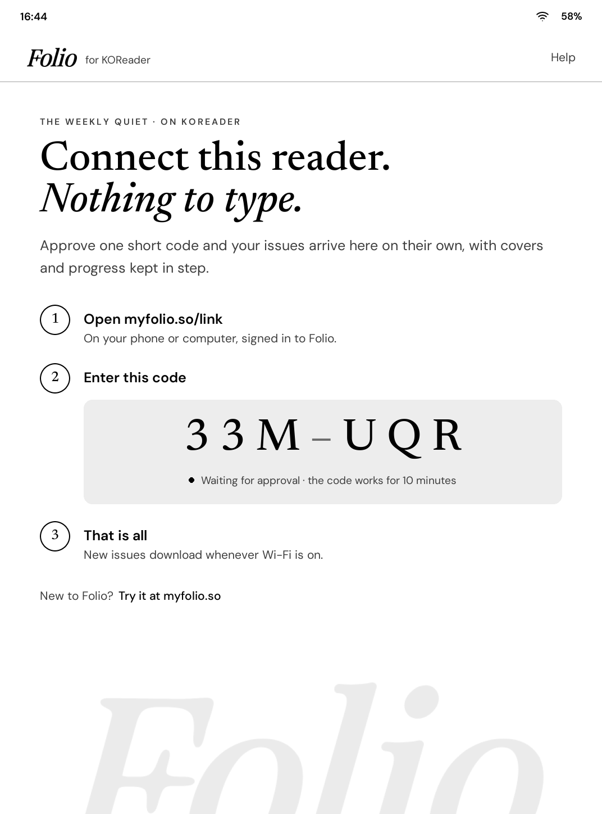
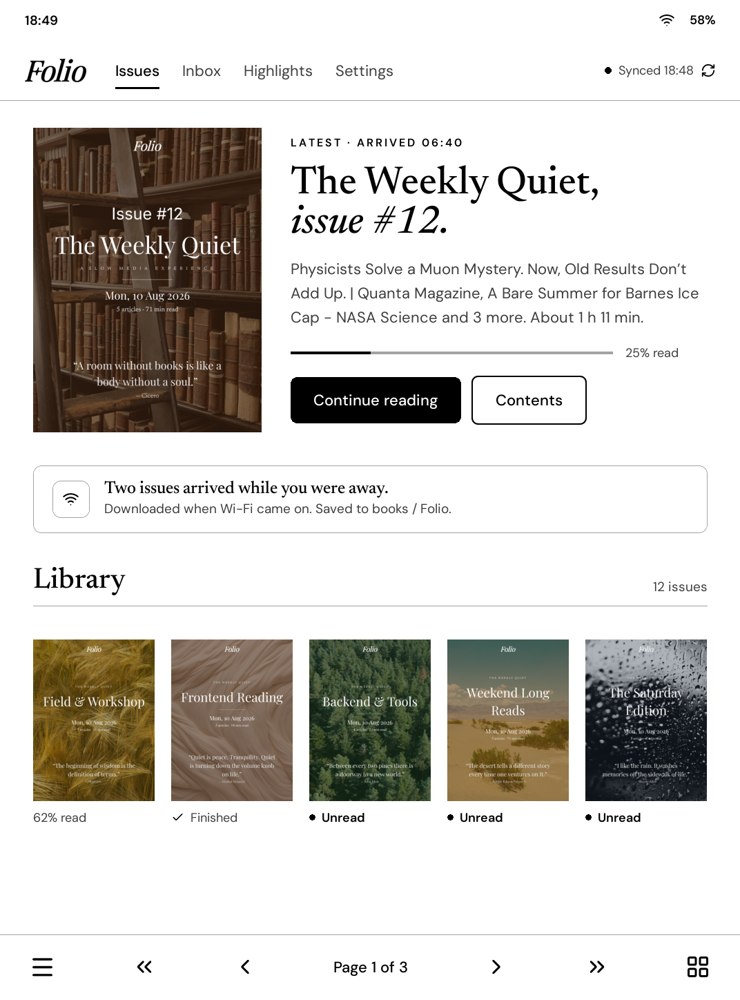
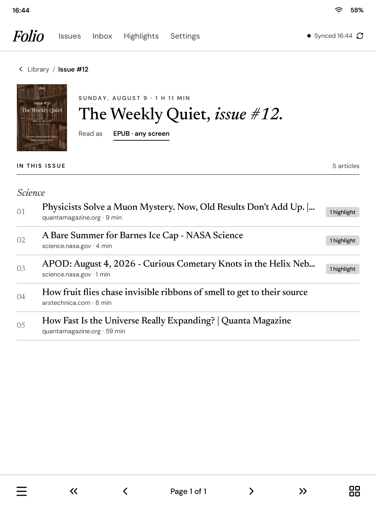
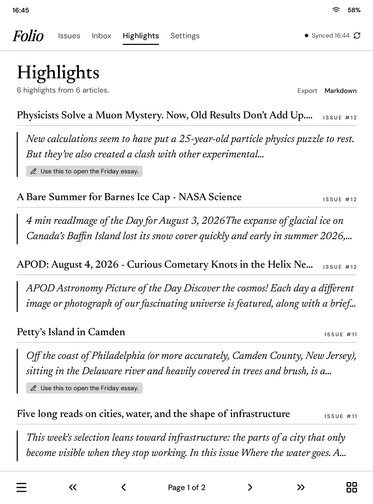
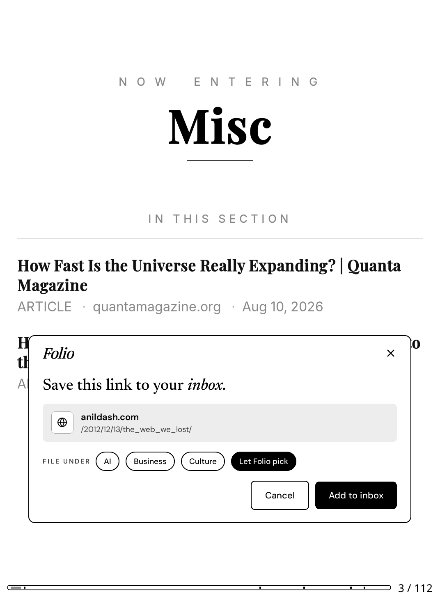

# Folio for KOReader

Get your [Folio](https://myfolio.so) issues on any e-reader that runs [KOReader](https://koreader.rocks): Kobo, PocketBook, Kindle (jailbroken), Boox, reMarkable and more.

- **Connect with a code.** No typing passwords on e-ink. The reader shows a 6-character code, you enter it at [myfolio.so/link](https://myfolio.so/link).
- **New issues arrive on their own.** Whenever Wi-Fi comes on, new issues download into a `Folio` folder.
- **Make an issue from your inbox.** Pick articles and tap *Make an issue*.
- **Save links while you read.** Tap a link in any book and choose *Save to Folio inbox*.
- **Your highlights in one place.** Everything you highlight in a Folio issue, grouped by article, with a Markdown export.

## Install

1. Download `folio.koplugin.zip` from the [latest release](../../releases/latest).
2. Unzip it. You get a folder called `folio.koplugin`.
3. Copy that folder into KOReader's `plugins` folder on your reader:
   - Kobo: `.adds/koreader/plugins/`
   - Kindle: `koreader/plugins/`
   - PocketBook: `applications/koreader/plugins/`
   - Android: `koreader/plugins/` on internal storage
4. Restart KOReader.

## Use

Open the top menu and go to **Tools → Folio**. The first time, Folio shows a short code: open [myfolio.so/link](https://myfolio.so/link) on your phone, sign in, and type it.

After that, **Tools → Folio** opens your Folio screen:

| Tab | What it does |
|-----|--------------|
| Issues | Your latest issue and your library. Tap a cover to see what's inside. |
| Inbox | Saved articles. Tick a few and tap *Generate issue*. *Add link* saves a new one. |
| Highlights | What you've highlighted in your issues. *Markdown* saves them to a file. |
| Settings | Auto-download on Wi-Fi, folder, how many issues to keep, EPUB or PDF, and Disconnect. |

Issues come as EPUB by default, so they fit your screen and font settings.

## Privacy

The plugin only talks to `myfolio.so`. It stores one sign-in token in KOReader's `settings/folio.lua`. *Disconnect* deletes it on the reader and on Folio.

## License

MIT
